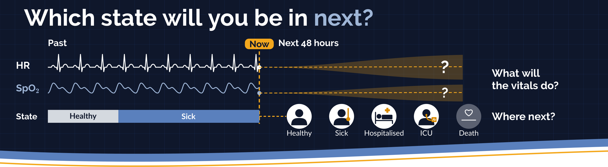
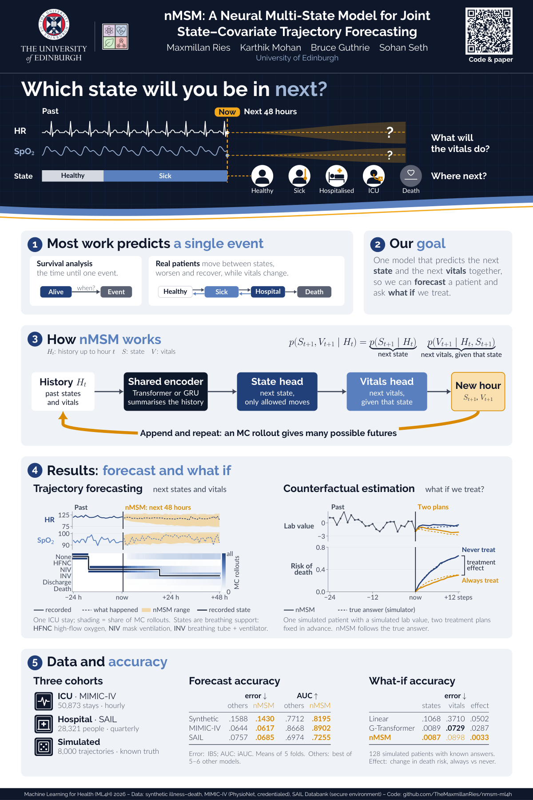
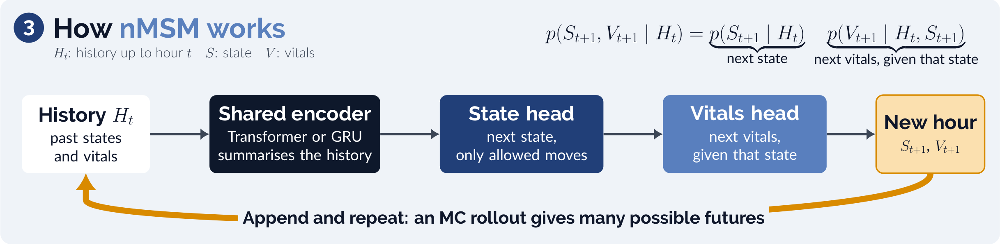
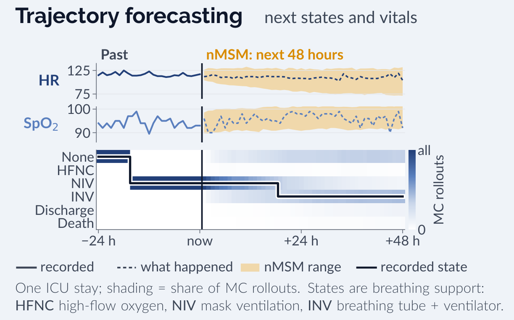
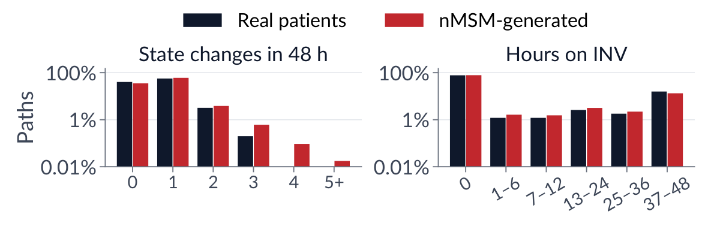
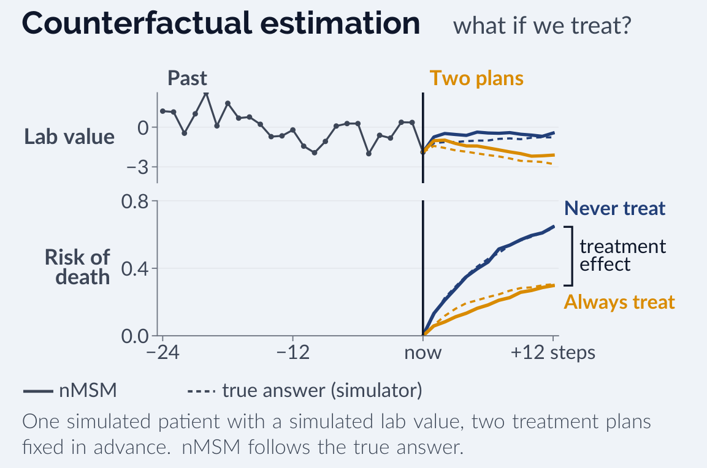

<div align="center">

# nMSM: A Neural Multi-State Model for Joint State–Covariate Trajectory Forecasting

**Maxmillan Ries · Karthik Mohan · Bruce Guthrie · Sohan Seth**<br>
University of Edinburgh

*Machine Learning for Health (ML4H) 2026 — Proceedings Track*

[**Project page**](https://TheMaxmillanRies.github.io/nmsm-ml4h/) ·
[**Paper**](#citation) ·
[**Poster (PDF)**](docs/nmsm_ml4h2026_poster.pdf) ·
[**Code**](#code)

</div>

---

<p align="center"></p>

**TL;DR.** Multi-state models (MSMs) describe how patients move between clinical states. Recent neural MSMs
forecast those moves well, but they forecast **states only**: they do not model how the measurements that drive
the moves evolve after the forecast starts. **nMSM** generates the next state *and* the measurements that follow
it, feeds them back in, and repeats. One fitted model gives both state-occupation forecasts and complete,
coherent patient trajectories.

## Contents
- [The poster](#the-poster)
- [The problem](#the-problem)
- [How nMSM works](#how-nmsm-works)
- [Data](#data)
- [Results](#results)
- [Limitations](#limitations)
- [Code](#code): [install](#install) · [data](#data-preparation) · [train](#train) · [evaluate](#evaluate)
- [Citation](#citation)

## The poster

<p align="center"><a href="docs/nmsm_ml4h2026_poster.pdf"></a></p>
<p align="center"><sub>Click for the full-resolution PDF.</sub></p>

## The problem

First-event survival analysis models the time until one event. Real clinical courses involve intermediate
conditions, repeated deterioration and recovery, and eventual absorbing outcomes such as discharge or death.
MSMs represent this as transitions among mutually exclusive states on a directed graph.

Forecasting these trajectories raises two challenges:

1. **The current snapshot is not enough.** Identical current measurements can follow steady recovery or a recent
   complication, so the model needs the ordered history, including *what* was measured and *when*.
2. **Future transitions depend on future measurements.** Those measurements are unknown beyond the forecast
   start. Fixed covariates cannot represent this feedback, and externally supplied update rules need a separate
   model of how covariates continue.

| Method | Longitudinal covariates | Multi-state graph | Joint forecast |
|---|:-:|:-:|:-:|
| msCox | ◦ | ✓ | × |
| SurvNODE | × | ✓ | × |
| msPseudo | × | ✓ | × |
| IDNetwork | × | ◦ | × |
| MSnet | × | ◦ | × |
| MixMarkov | × | ✓ | × |
| TransformerLSR | ✓ | × | ✓ |
| G-Transformer | ✓ | × | ✓ |
| **nMSM-T / nMSM-GRU** | ✓ | ✓ | ✓ |

<sub>Forecasting scope of selected methods (paper, Table 1). Joint: future covariates and states or event outcomes.
✓ supported; × absent; ◦ supplied covariates or progressive-only graphs.</sub>

## How nMSM works

<p align="center"></p>

nMSM is a discrete-time autoregressive model. States and measurements are aligned to a common time grid
(one synthetic step, one ICU hour, or one SAIL quarter), and each step does the following.

**1. Encode the history.** Each row holds the clinical state, the measurements, and, for every feature, a
**missingness mask** (was it newly measured?) and a **time gap** (steps since it was last measured). Values are
carried forward, and the mask and gap keep stale values distinguishable from fresh ones. Dwell time in the
current state, baseline covariates and binary attributes are also inputs. A causal **Transformer** (nMSM-T) or a
**GRU** (nMSM-GRU) maps the history $H_t$ to a shared representation $h_t$.

**2. Sample the next state, using only allowed moves.** The state graph is imposed directly. With adjacency
$A$ and current state $a$, the state head gives log-odds $\eta_{t,b}$ of moving to each permitted destination
$b \in \mathcal{A}(a)$, relative to staying:

$$
p_{t,b} =
\begin{cases}
\dfrac{\exp(\eta_{t,b})}{1 + \sum_{c \in \mathcal{A}(a)\setminus\{a\}} \exp(\eta_{t,c})}, & b \in \mathcal{A}(a),\ b \neq a,\\[2ex]
1 - \sum_{c \in \mathcal{A}(a)\setminus\{a\}} p_{t,c}, & b = a,\\[1ex]
0, & \text{otherwise.}
\end{cases}
$$

Prohibited transitions get zero probability by construction, and absorbing states only lead to themselves.

**3. Sample the covariates given that state.** Measurements can differ by destination (staying on a ward
versus entering intensive care), so the covariate head is conditioned on the sampled next state. With
$V_{t+1}$ the next measurements, observation indicators and binary covariates,

$$
p_{\theta,\phi}(S_{t+1}, V_{t+1} \mid H_t) = p_\theta(S_{t+1} \mid H_t)\; p_{\theta,\phi}(V_{t+1} \mid H_t, S_{t+1}).
$$

The head predicts, for each feature, whether it is measured ($M \sim \mathrm{Bernoulli}(\rho)$), its value if
measured ($X^{\mathrm{obs}} \sim \mathcal{N}(\mu, \sigma^2)$), and binary covariates ($B \sim \mathrm{Bernoulli}(\nu)$).
The future **recording pattern** is therefore generated as well, with no external observation schedule.

**4. Append the generated row and repeat.** A measured feature replaces the carried value and resets its gap;
otherwise the gap grows. Dwell time resets on a state change. The completed row becomes history for the next
step: this is the **state–covariate loop**.

**Forecasting with an MC rollout.** From a landmark history $H_L$, nMSM samples $R$ Monte Carlo trajectories
over the horizon. State-occupation probabilities average the state-head probabilities across the simulated
histories (Rao-Blackwellising the final draw):

$$
\hat P_{L,L+h}(k) = \frac{1}{R} \sum_{r=1}^{R} p_\theta\!\left(S_{L+h} = k \mid H^{(r)}_{L+h-1}\right).
$$

Averaging the paths gives occupation forecasts. Keeping the paths gives full trajectories, which answer
**pathway questions**: how many state changes, how long on invasive ventilation, and with what measurements along
the way.

**Training.** The objective is $\mathcal{L} = \mathcal{L}_{\text{state}} + \lambda_{\text{cov}}\,\mathcal{L}_{\text{cov}}$.
Because generated values are fed back, accurate conditional means matter. In the mean-focused fits, squared error
trains $\mu$ and the shared representation, while the Gaussian likelihood trains $\sigma$ with gradients restricted
to the scale head.

## Data

| | Synthetic | MIMIC-IV | SAIL |
|---|---|---|---|
| Cohort | 8,000 illness–death trajectories | 50,873 ICU stays | 28,321 participants |
| Time step | one interval | one hour | one quarter |
| States | Healthy, Sick, Death | None, HFNC, NIV, INV, Discharge, Death | 0, 1, 2–4, 5+ hospital admissions per quarter, Death |
| Horizon | 12 steps | 48 hours | 6 quarters |
| Landmarks | steps 15 / 24 / 37 | hours 24 / 48 / 84 | rounded follow-up quartiles |

- **Synthetic** trajectories have explicitly history-dependent transition risk: a controlled test of whether
  ordered history adds information beyond the current observation.
- **MIMIC-IV** has hourly respiratory-support states (HFNC: high-flow nasal cannula oxygen; NIV: non-invasive ventilation;
  INV: invasive ventilation), irregular physiological measurements, and absorbing discharge or death.
- **SAIL** has quarterly hospital-admission states and absorbing death: a low-frequency, long-horizon
  administrative setting.

All methods share five patient-level outer folds, prediction targets and landmarks. Landmark-conditional IPCW
handles right censoring. Metrics: integrated Brier score (**IBS**), time-integrated AUROC (**iAUC**), multiclass
NLL, MAE and ECE. Comparisons use corrected resampled tests with Holm adjustment.

**Comparators:** msCox (classical statistical MSM), MixMarkov (state-path simulator), SurvNODE, IDNetwork and
msPseudo (neural state forecasting), and a snapshot **Direct MLP** that predicts occupation from the landmark
state and covariates without any earlier history.

## Results

### State forecasting

Across all datasets and landmarks, **both nMSM variants achieve the best mean IBS and iAUC** among the evaluated
methods. The table shows the middle landmark (Q50); the paper reports all three landmarks and all metrics.

| Method | Synthetic IBS ↓ | Synthetic iAUC ↑ | MIMIC-IV IBS ↓ | MIMIC-IV iAUC ↑ | SAIL IBS ↓ | SAIL iAUC ↑ |
|---|:-:|:-:|:-:|:-:|:-:|:-:|
| msCox | .1588 | .7695 | .0723 | .8007 | .0769 | .6864 |
| SurvNODE | .1703 | .7083 | .0699 | .8116 | – | – |
| IDNetwork | .1709 | .7101 | .0693 | .8148 | .0895 | .6075 |
| msPseudo | .1711 | .7025 | .0695 | .7567 | .0890 | .6265 |
| MixMarkov | .1713 | .7182 | .0722 | .8111 | .0911 | .6504 |
| Direct MLP | .1591 | .7712 | .0644 | .8668 | .0757 | .6974 |
| **nMSM-T** | **.1430** | **.8195** | .0626 | .8858 | **.0685** | **.7255** |
| **nMSM-GRU** | .1437 | .8186 | **.0617** | **.8902** | .0701 | .7195 |

<sub>Five-fold means at the Q50 landmark, integrated over horizons (paper, Table 2). Bold: best per column.
SAIL omits SurvNODE because secure-environment compute limits prevented timely training.</sub>

The advantage over the snapshot Direct MLP is largest on the history-dependent synthetic task. On MIMIC-IV the
gap is narrower, but nMSM keeps a significant IBS advantage at every landmark, which supports the value of ordered
history beyond the current clinical snapshot.

<p align="center"></p>

### Breaking the loop makes forecasts worse

Targeted ablations on MIMIC-IV, as the change in IBS versus the matched nMSM-T (positive = worse):

| Control | ΔIBS |
|---|:-:|
| *Refitted:* no missingness masks or time gaps | +.00336\* |
| *Refitted:* no next-state conditioning | +.00121 |
| *Frozen model:* roll out with conditional means, not samples | +.00177\* |
| *Frozen model:* roll out with carried-forward values (value-LOCF) | +.00221\* |
| *Frozen model:* scrambled earlier history | +.00214\* |

<sub>Paper, Table 3. \*: p < .05, unadjusted corrected resampled test. Five folds, 500 paths.</sub>

Removing masks and gaps hurts most, so *when* something was measured carries information. Replacing generated
measurements with means or carried-forward values also hurts, so the generated covariates carry the state
forecast rather than being a side output.

### Generated paths look like real ones

<p align="center"></p>

Across 500 held-out MIMIC-IV stays (500 paths each), nMSM-T closely reproduces the observed distributions of
state-change counts and cumulative invasive-ventilation duration. Across 16 variables, 98.54% of newly generated
measurements stay within preprocessing ranges. Discharge occupation at 48 hours is overpredicted, so matching
these path summaries does not mean the full trajectory distribution is recovered.

### What if we treat? Policy evaluation by rollout

<p align="center"></p>

Fix the action at every step, roll out, and compare. Because covariates are generated, a treatment can change
the measurements that drive later transitions, which is longitudinal g-computation inside the same model. On a
synthetic simulator with known policy outcomes:

| Method | Occupation MAE | Covariate RMSE | Death \|Δ\| |
|---|:-:|:-:|:-:|
| Linear | .1068 | .3710 | .0502 |
| G-Transformer | .0089 | **.0729** | .0287 |
| **nMSM-T-cal** | **.0087** | .0898 | **.0033** |

<sub>Paper, Table 4: 128 histories, two-seed mean errors, lower is better. |Δ|: error in the always-minus-never
death risk at step 12. nMSM-T-cal adds nine mean corrections.</sub>

nMSM matches G-Transformer on occupation error and has lower death-contrast error, but a higher covariate RMSE:
accurate policy contrasts do not guarantee equally accurate intermediate covariates. Clinical use would also
require consistency, sequential exchangeability and positivity.

### Fast occupation forecasts

Full MC rollout is only needed when complete trajectories are. A lightweight head trained on the frozen encoder
approximates the rollout's occupation forecasts in one pass, reducing matched CPU inference from 2336.49 to
1.41 ms per history across 683 held-out histories, with similar IBS, NLL and ECE.

## Limitations

- **Errors can accumulate**, because generated measurements are fed back into later predictions. Covariate
  prediction error grows with the horizon.
- **Gaussian emissions** occasionally leave preprocessing ranges and do not capture residual cross-variable
  dependence.
- **Transportability** may depend on local recording practice, because nMSM learns the observation process.
- The clinical graphs are **dense among living states** and use a **fixed time grid**. Sparse graphs and
  continuous-time formulations remain to be tested.

---

## Code

This repository contains the model, preprocessing, training and evaluation code for the **primary synthetic and
MIMIC-IV comparison**. It contains **no patient data and no trained weights**. Exploratory appendix and
counterfactual experiments are not packaged here.

```
reproduce.py                  # single entry point (prints a plan unless --execute)
configs/                      # architecture choices and reported run settings
scripts/                      # data preparation, training, baselines, evaluation
src/nmsm_ml4h/
  model.py                    # nMSM encoder (Transformer / GRU) and joint state–covariate heads
  rollout.py                  # autoregressive path generation (the state–covariate loop)
  data.py                     # history encoding: values, masks, gaps, landmarks
  training.py, losses.py      # likelihood and mean-focused training
  mean_training.py            # mean-focused objective for state occupation
  evaluation.py, metrics.py   # IBS, iAUC, NLL, MAE, ECE, IPCW
  path_scoring.py             # path-level summaries (transition counts, durations)
  *_baseline.py, *_general.py # msCox, SurvNODE, IDNetwork, msPseudo, MixMarkov, Direct MLP, GRU
```

### Install
Python ≥ 3.10. Install a PyTorch build for your platform first, then:

```bash
python -m pip install -e .
```

`requirements-cpu-tested.txt` records the tested environment (Python 3.10, PyTorch 2.6.0).

### Data preparation
```bash
# Synthetic: 8,000 subjects, seed 42, five patient folds (seed 2026)
python reproduce.py prepare-synthetic --execute

# MIMIC-IV: credentialed hourly respiratory-support dataset v1.1.0
python reproduce.py prepare-mimic --raw-root /path/to/files --execute
```

The MIMIC input is the [PhysioNet temporal respiratory-support dataset v1.1.0](https://physionet.org/content/temporal-respiratory-support/1.1.0/)
(Moukheiber et al., 2025), available to credentialed researchers. Point `--raw-root` at the directory containing
the `100/`, `101/`, … patient folders, not the raw MIMIC relational tables. The study used 50,873 prepared stays.
Check cohort identity before claiming replication. SAIL analyses ran inside the SAIL secure environment, and those
data cannot be redistributed.

### Train
```bash
python reproduce.py train --dataset synthetic_full --device cuda --execute
python reproduce.py train --dataset mimic          --device cuda --execute
```

Without `--execute`, commands only print the plan. Useful options: `--folds 0`, `--methods nmsm_t nmsm_gru`,
`--device cpu`, `--data-root PATH`, `--output PATH`, and `--stage fit|evaluate` for nMSM-T. Use a fresh output
directory when you change settings.

<details>
<summary>Training notes</summary>

- Both Transformers and the MIMIC GRU use mean-focused training. The synthetic GRU keeps its original likelihood objective.
- The MIMIC GRU inherits the Transformer's validation settings, so run nMSM-T first.
- All primary evaluations use 500 paths at three landmarks.
- SurvNODE uses the saved feasible-fit settings: width 256, AdamW at 1e-4, 30 epochs, patience 5.
- Direct MLP predicts occupation directly. It does not generate joint paths.
- The primary trainer pins CPU cores 0,1 by default (`--cpu-affinity`).
- The T trainer caps GPU allocation at 6 GiB with a 6 GiB free-memory reserve. The MIMIC GRU uses a 12 GiB cap. Baselines lack these guards.
</details>

### Evaluate
```bash
python scripts/summarize_primary.py --runs runs --data-root data --output results
```

This needs complete runs for both datasets and all methods. It reports IBS, iAUC, NLL, MAE and ECE, with corrected
resampled tests and Holm adjustment. msPseudo uses state-specific sigmoid outputs that do not sum to one, so its
native outputs do not define the categorical NLL used here.

> Keep locally generated MIMIC predictions and patient split files private.

## Citation
```bibtex
@inproceedings{ries2026nmsm,
  title     = {{nMSM}: A Neural Multi-State Model for Joint State--Covariate Trajectory Forecasting},
  author    = {Ries, Maxmillan and Mohan, Karthik and Guthrie, Bruce and Seth, Sohan},
  booktitle = {Proceedings of the Machine Learning for Health (ML4H) Symposium},
  series    = {Proceedings of Machine Learning Research},
  year      = {2026}
}
```

## License and third-party code
The license for the authors' code will be added as `LICENSE`. See [`THIRD_PARTY_NOTICES.txt`](THIRD_PARTY_NOTICES.txt)
for baseline provenance. Some baselines are reimplementations, not official author code. MixMarkov's Apache-2.0
license is kept in `THIRD_PARTY_LICENSES/`.
